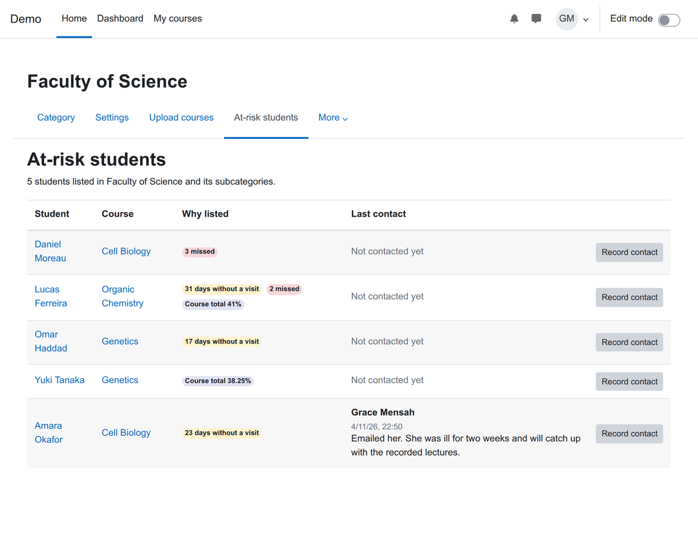
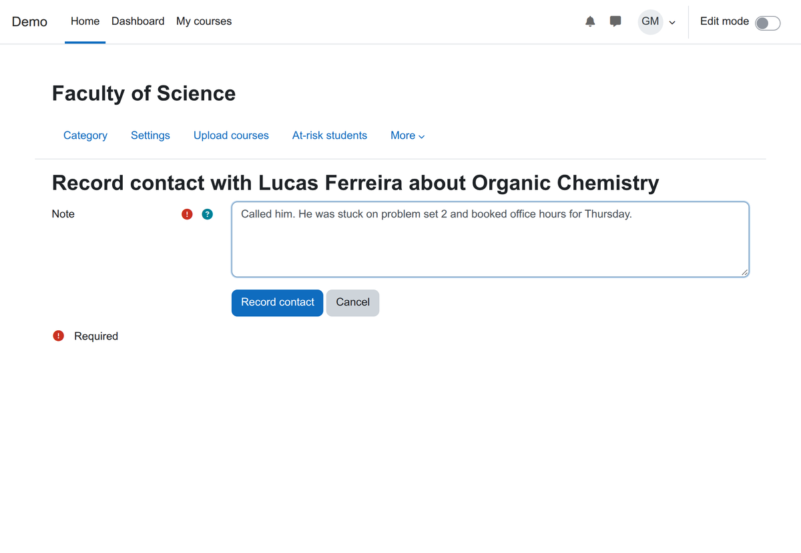

# At-risk students for Moodle (local_atrisk)

[](https://github.com/devlms/moodle-local_atrisk/actions/workflows/ci.yml)
[](https://devlms.github.io/moodle-local_atrisk/)
[](https://devlms.github.io/moodle-local_atrisk/php-coverage/)
[](https://moodledev.io/general/releases)
[](LICENSE)
[](https://www.php.net/supported-versions.php)
[](version.php)

One page per course category that lists the students who stopped opening a course, missed assignment deadlines, or have a low course total, with the reason next to each name. Staff record who they contacted and what was agreed, so nobody gets called twice and nobody gets forgotten.

Moodle can show a teacher who has not visited one course, and its Analytics model can predict dropout once it has past data to learn from. A programme lead or a student support team needs every struggling student across the courses they look after, in one list, with a plain reason and a shared record of who already reached out. That is what this plugin adds.



## What it does

| Part | Status |
| --- | --- |
| Flags students with no visit to a course for N days (counted from enrolment if they never opened it) | Done |
| Flags students with N or more assignments past their due date and not submitted; extensions that have not run out do not count | Done |
| Flags students whose course total is under N%, out of their own maximum so ungraded work does not count against them; can be turned off | Done |
| Only active students: teachers, suspended enrolments and hidden courses are left out | Done |
| A scheduled task rebuilds the list every four hours, so solved problems drop off | Done |
| An At-risk students tab on each course category, covering its subcategories | Done |
| Record a contact with a note; the list shows who, when and the note | Done |
| Log event for each contact. Privacy API export and delete for flags and contacts | Done |
| Quiz, forum or attendance signals; per-course thresholds; messaging students from the list | Planned |



## Install

Needs Moodle 4.5 to 5.3.

```bash
# Moodle 4.5 and 5.0
git clone https://github.com/devlms/moodle-local_atrisk.git local/atrisk
# Moodle 5.1 and later
git clone https://github.com/devlms/moodle-local_atrisk.git public/local/atrisk
```

Then visit Site administration, Notifications. Set the thresholds under Site administration, Plugins, Local plugins, At-risk students. The first list appears after the scheduled task "Refresh at-risk students" runs.

## Permissions

| Capability | Default roles | Allows |
| --- | --- | --- |
| `local/atrisk:view` | Manager | See at-risk students in a category and its subcategories, and record contacts |

Give the capability to a programme lead or support role on their own category, and they see only those courses.

## Privacy

Flags are rebuilt from course data and deleted with the student. Contact notes belong to the student; deleting the staff member who wrote one keeps the note and removes only their id.

## Tests

PHPUnit covers each rule and its edge cases (never visited, extensions, ungraded work in a natural aggregation total, teachers, suspended students, hidden courses, a flag clearing when its reason goes), the category list with subcategories and the latest contact, the page's template context, events and the privacy provider. Behat sets up a category with four students, runs the scheduled task, walks a manager through the list and recording a contact in a real browser, and checks that a teacher without the capability sees nothing. CI runs on Moodle 4.5 to 5.3 with PostgreSQL and MariaDB: [reports](https://devlms.github.io/moodle-local_atrisk/).

## Who made it

[DevLMS](https://devlms.com) builds custom Moodle plugins. Need other signals, per-course thresholds, or the list sent to your CRM? [Get a quote](https://devlms.com/work/at-risk-students/).

## License

GNU GPL v3 or later.
